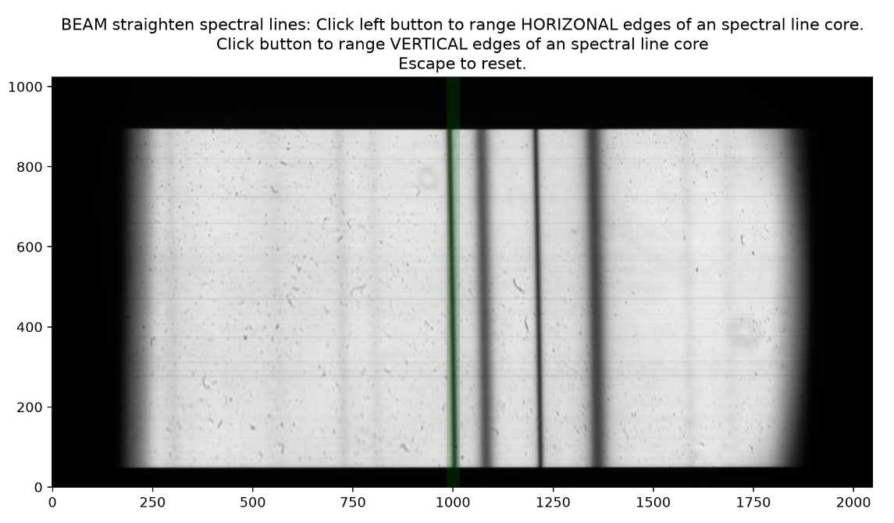
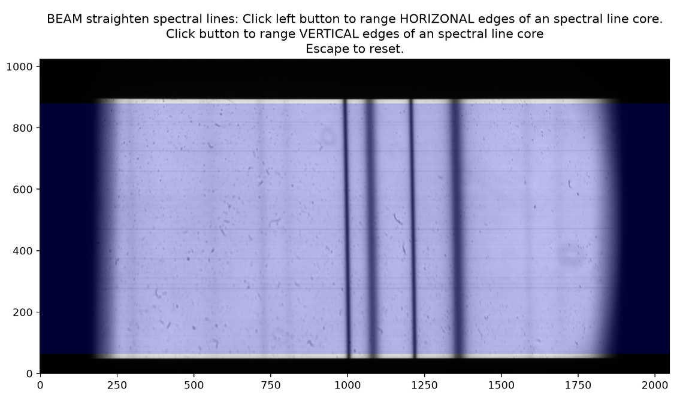
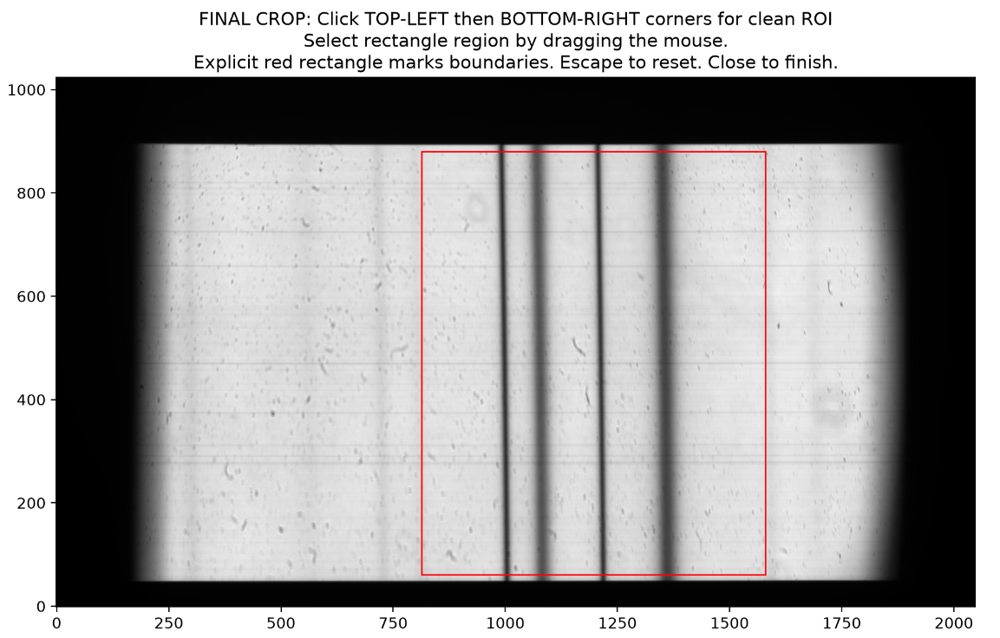
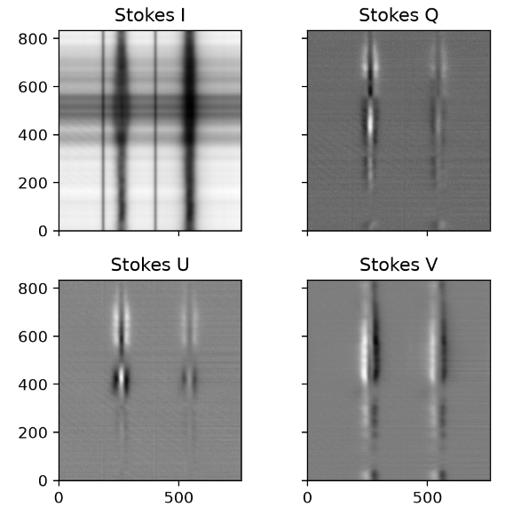
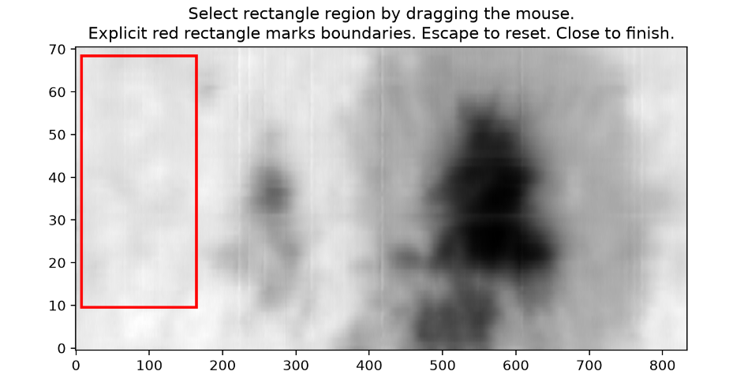
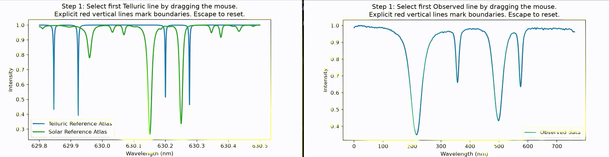
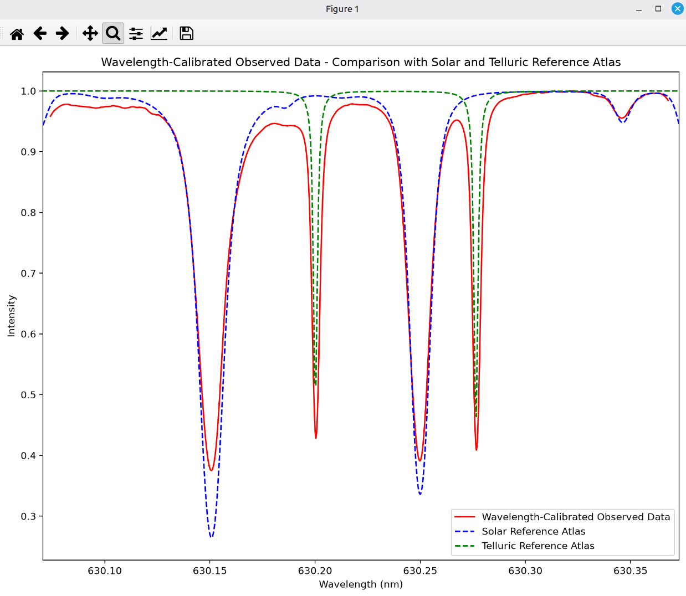
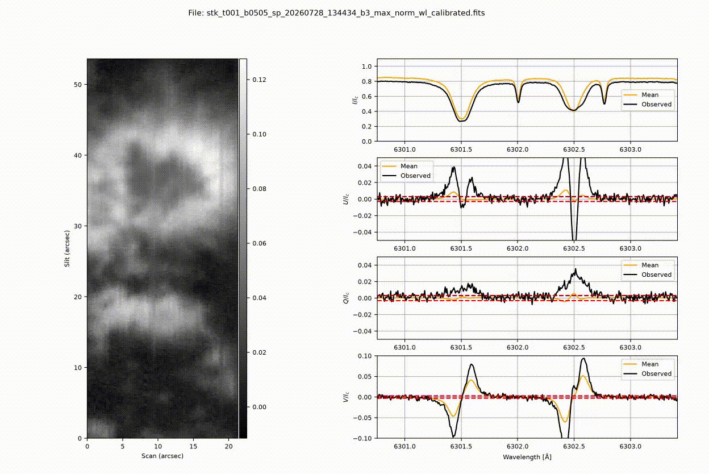

## Calibration procedure: MulTi-Ray spectrograph (MTR2)

This tutorial introduces the procedure for calibrating L0 data to generate L1 and L1.5 data products for the MTR2 instrument. The scripts here are included and run in a Python 3 environment with the following requirements:

`astropy==8.0.1
matplotlib==3.11.2
numpy==2.5.4
pandas==3.0.6
scipy==1.18.1
skimage==0.0
sunpy==8.0.0
tqdm==4.68.4`

If you have access to THEMIS computers, you can activate the specific environment build using a Terminal:

`conda activate pythemis`

### 1. Dual-beam MTR2 calibration:

First, run `python main_prep_MTR2_v2.py` and follow the prompts to provide the necessary input file paths, save path, and validation requests. Initially, indicate if you are processing full polarimetric data (Stokes I, Q, U, V) or spectroscopic data (Stokes I). This script processes the raw science using the flat-field and dark-frame files. The dual-beam MTR2 system has a slight misalignment between the two beams, which the script corrects using an affine transformation. Additionally, the spectral lines exhibit curvature, which the script corrects by straightening them using polynomial fitting. For this procedure, manually select a spectral line (x (green strip) and y (blue strip) range) to align and de-curve for both beams (polarimetry mode) or one beam (spectroscopy mode). Then select a clean region of interest, which will be the final spectral and spatial (along the slit) region used for calibration.  

In the polarimetry mode, the script computes the alignment and scale factor of both beams and extracts the final Stokes matrix result of the beam combination per scan. In the spectroscopy mode, the script computes the alignment and extracts a final Stokes I profile per scan.

A new FITS file will be created, namely stk_*name of the original file*..fits, and saved in the save path. Use this FITS file for the next calibration step.

You can calibrate several files at once by providing a file path using '\*' as a regular expression; for example, /home/MTR2/t0\*_b0505_\*_sp_b3.fits will process all sequences matching the expression.

### 2. Wavelength calibration using reference atlas of solar and telluric spectral lines:

Second, run `python wl_cal_v2.py` and follow the prompts to provide the FITS file created previously. This procedure performs a maximum-intensity normalisation and atlas wavelength calibration of the scans. First, select a region on the FOV to calculate the rest spectrum; choose a quiet Sun region. Then indicate the central spectral region of the data in nm, for example: 630.15 for scans of the iron line pair at 630.1 and 630.2 nm. Following, indicate the number of telluric lines to calibrate (max 2). If no telluric lines are in the observed spectral range, use two solar lines for calibration. Manually select the spectral range for each line (Telluric only, Solar/Telluric, or Solar only) in the pop-up windows. Close both windows to continue. A comparation plot will appear including the solar/telluric atlas and the calibrated-wavelength rest profile. Finally, you will be asked whether to bin in the spectral dimension. Typically, when recording spectra with Zyla cameras, select binning to achieve optimal spectral sampling.

A new FITS file will be created, namely stk_*name of the original file*__max_norm_wl_calibrated.fits, which you should use for checking.

You can calibrate several files at once by providing a file path using '\*' as a regular expression; for example, /home/MTR2/t0\*_b0505_\*_sp_b3\*.fts will process all sequences matching the expression.

### 3. Evaluate the scan run

You can inspect the final calibrated files by running `python checking_stk_inv.py`, then follow the prompts to provide the created FITS file. If you have synthetic profiles from an inversion code, you can add the FITS file to compare with observations. If not, type `None` when prompted. A figure will appear showing the FOV observed and profile plots of the full polarimetric data (Stokes I, Q, U, V) or spectroscopic data (Stokes I). You can navigate both axes to interactively select spectral profiles per pixel and a spectral image per wavelength. 

You can inspect several files at once by providing a file path using '\*' as a regular expression. Two buttons will appear to navigate between the files. To fix a spectral position, click it with the left mouse button; to release it, click it with the right mouse button.
